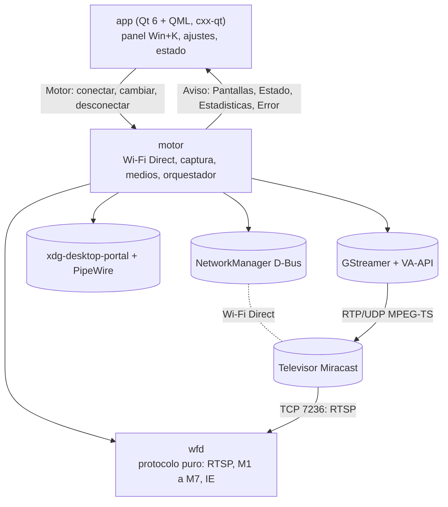
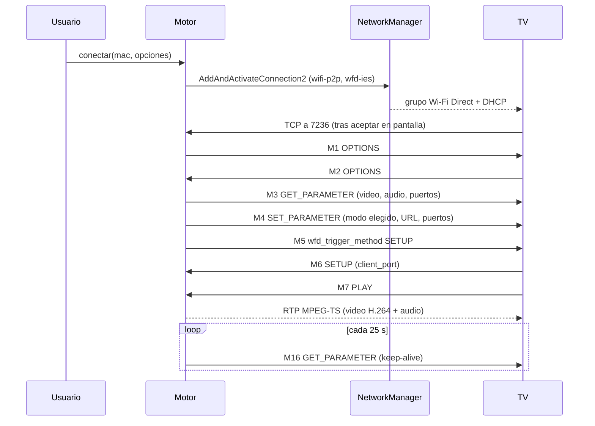

# Proyectar - Arquitectura

## Control de cambios

| Versión | Fecha | Autor | Descripción del cambio |
| --- | --- | --- | --- |
| 1.0.0 | 2026-10-12 | Andrés García | Versión inicial: crates, flujo M1 a M7, recuperación, decisiones y descartes |
| 1.0.1 | 2026-10-12 | Andrés García | Revisión para publicar: equipo de referencia descrito de forma genérica |

## 1. Vista general

Espacio de trabajo Cargo con tres capas. Cada una solo conoce a la de abajo.



| Crate | Responsabilidad | Estado en 0.1.0 |
| --- | --- | --- |
| `crates/wfd` | Mensajes RTSP, negociación M1 a M7, keep-alive, IDR a pedido, elementos de información (IE). Sin sockets propios: opera sobre cualquier `AsyncRead + AsyncWrite` | Implementado con pruebas |
| `crates/motor` | `wifi_direct` y `nm` (descubrir y enlazar), `captura` (portal), `medios` (GStreamer), `modo` (latencia y fuente), `recientes`, `fallo` (política de recuperación), `proyeccion` (orquestador `Motor`) | `medios` y `proyeccion` en escritura |
| `app` | Interfaz Qt/QML Dracula; solo traduce avisos a propiedades y clics a órdenes | Pendiente |

`wfd` no tiene política de entrada y salida ni dependencias de plataforma; por eso se prueba con un
televisor simulado en memoria (`tokio::io::duplex`). `motor` expone solo `Motor` (órdenes) y `Aviso`
(sucesos): la interfaz nunca espera al motor, y los avisos llegan por hilos propios del motor.

## 2. Flujo de una proyección

El emisor es el **servidor RTSP** (puerto 7236, el que anuncia en su IE); la TV se conecta a nosotros.
Del socket aceptado salen la IP local (para `wfd_presentation_URL`) y la IP destino del RTP, así que
no hace falta resolver la IP del par.



`Session::negotiate` cubre de M1 a M7 y devuelve `Negotiated` (modo de video, códec de audio, puerto
RTP). Después emite `Event::Play`, `Pause`, `IdrRequest` y `Teardown`. Al llegar `IdrRequest` el motor
fuerza un cuadro clave en el codificador. Si el par calla pasados `SESSION_TIMEOUT` (30 s), `wfd`
devuelve `Error::Timeout`.

## 3. Recuperación: Fallo -> Acción

Rust no tiene excepciones: cada paso devuelve `Result<_, Fallo>` y `Fallo::recovery()` hace de
`catch`, decidiendo la `Accion` en un solo lugar (`crates/motor/src/fallo.rs`).

| Fallo | Acción | Razón |
| --- | --- | --- |
| `Red` (D-Bus), `Io` | `Reintentar(2 s)` | Cosa transitoria del bus o del socket local |
| `WifiDirect`, `SinRespuesta` | `Reconectar` | El enlace murió o la TV no se conectó |
| `Protocolo` transitorio | `Reconectar` | `wfd::Error::is_transient`: cierre, tiempo, rechazo |
| `Protocolo` sin formato en común o mal formado | `Detener` | Reintentar no cambia el resultado |
| `Captura` | `NuevaCaptura` | El portal cerró el flujo |
| `CapturaCancelada` | `Detener` | El usuario cerró el diálogo |
| `Codificador` | `OtroCodificador` | Cadena: `vah264lpenc`, luego software; la sesión se conserva |
| `Medios` | `Reintentar(500 ms)` | Fallo breve de la cadena |

## 4. Decisiones y descartes

| Decisión | Motivo | Descartado |
| --- | --- | --- |
| Servidor RTSP en 7236, la TV se conecta | Es el comportamiento de Android y GND; evita buscar la IP del par | Cliente RTSP: no es el rol de un emisor |
| NetworkManager `wifi-p2p` con `ipv4=auto`, volátil | NM decide el rol (GO o cliente) y arranca DHCP; la Wi-Fi normal queda arriba | `wpa_supplicant` directo: duplica lo que NM ya hace |
| Sin `bind-activation` | Tumba el enlace si el proceso que llamó se va | `bind-activation=dbus-client` de GND |
| `vah264lpenc` con `vapostproc` | En el equipo de referencia (Intel Iris Xe) no existe `vah264enc`; el LP usa el motor de bajo consumo y evita copias a CPU | `x264enc`, `openh264enc`: solo como reserva |
| Anunciar IE `0x0010` con subelemento de nombre | La TV muestra un nombre legible | IE `0x0090` de GND |
| Portal de KDE con fuente virtual para Extender | `AvailableSourceTypes=7` (verificado); KWin crea `Virtual-<id>` | Crear salidas con `kscreen` (frágil) |
| Audio siempre presente (silencio si está apagado) | Samsung corta la negociación sin pista de audio | Video solo |

### Por qué no se reutiliza GND (GNOME Network Displays)

GND emite con latencia alta por cinco causas, todas del código y no del protocolo:
1. `gst_pipeline_set_latency` fijo en 500 ms para toda la cadena.
2. Colas del multiplexor con 1000 buffers y 500 ms de tiempo (el audio, 100000 buffers): ahí se acumula
   cerca de un segundo.
3. Bitrate recortado a 4096 kbit/s para "no saturar el Wi-Fi", insuficiente para 1080p30.
4. Codificación por software por omisión, con `videoscale` y `videoconvert` en CPU; su rama VA-API pide
   `vah264enc` o `vaapih264enc`, que aquí no existen.
5. GOP de 30 con detección de escena que mete cuadros IDR no planeados; con `vaapih264enc` ni atiende
   `wfd_idr_request`.

Proyectar pone colas de 1 a 4 buffers con descarte (`leaky=downstream`), bitrate de 8000 a 14000 kbit/s
según el perfil, `key-int-max` igual a los fps y solo cuadros IDR a pedido o planeados.

## 5. Cadena de medios (objetivo)

```text
pipewiresrc (portal) ! queue leaky ! videorate ! vapostproc ! vah264lpenc (cbr, sin B-frames)
  ! h264parse ! mpegtsmux (alignment=7, PMT 0x1000, video 0x1011, audio 0x1100)
  ! rtpmp2tpay pt=33 ! udpsink (puerto pedido por la TV, sync=false)
```

`pipewiresrc` lleva `always-copy=true`: sin eso el codificador retiene el pool de PipeWire y la
captura muere a los pocos segundos.
